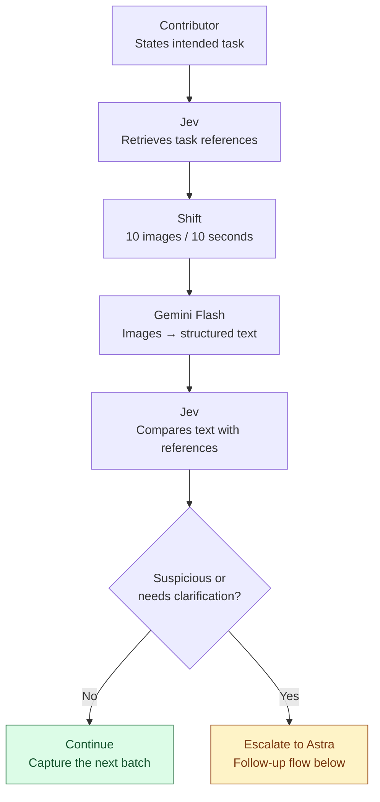
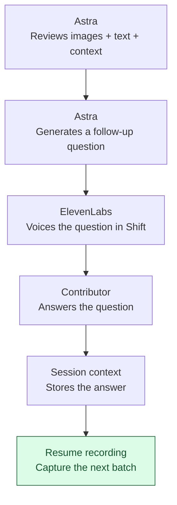

# AI Physical Hack

## Architecture

### 1. Observe and compare

Retrieve reference annotations once after the contributor states the task. Reuse them for each new batch.

**Continue** returns to Shift’s next batch, without repeating reference retrieval.

### 2. Clarify with voice

Astra receives the **original images**, **Flash’s structured text**, **reference annotations**, **Jev’s escalation reason**, and **session context**.

The next batch goes through **Flash → Jev**. Jev uses the updated session context when comparing the new annotations.

## Full flow

1. **The contributor states their intended task.**
2. **Jev retrieves the relevant reference annotations** from MicroAGI’s database: legitimate and fraudulent examples for that task.
3. **Shift collects a batch of 10 images over 10 seconds.**
4. **Gemini Flash converts those images into structured text annotations**, describing the activity frame by frame.
5. **Jev compares the live annotations with the retrieved references**, considering the declared task and previous answers.
6. **If everything looks consistent, continue recording** and process the next batch.
7. **If Jev detects suspicious behaviour or needs clarification, escalate to Astra.** Send:
   - The original batch images.
   - Gemini Flash’s structured text.
   - Relevant reference annotations and Jev’s reason for escalating.
   - The declared task and conversation history.
8. **Astra examines the images and text together and generates a targeted follow-up question.** ElevenLabs voices the question in Shift for the contributor.
9. **The contributor’s answer enters the session context.** The next image batch goes through Gemini Flash, and Jev assesses the new annotations with that additional context.

**Declare task → Retrieve references → Image batch → Flash annotations → Jev comparison → Astra follow-up when needed → ElevenLabs voice → Answer and next batch.**
