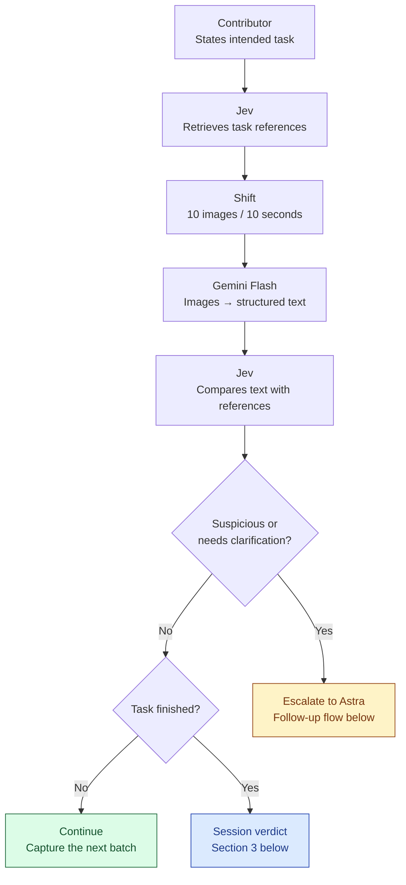
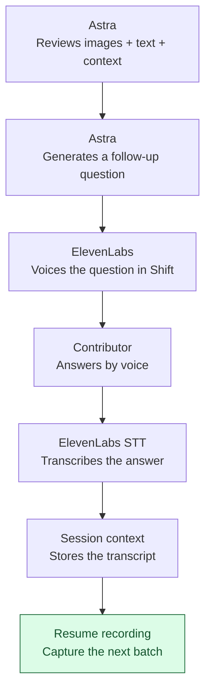
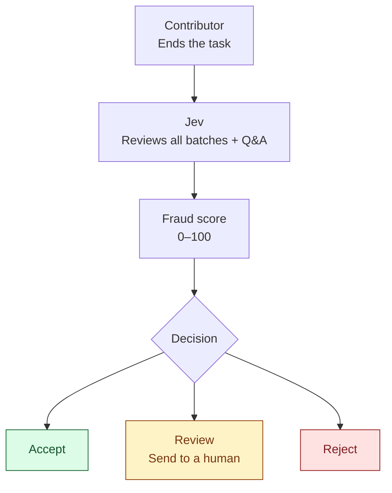

# AI Physical Hack

## Architecture

### 1. Observe and compare

Retrieve reference annotations once after the contributor states the task. Reuse them for each new batch.



**Continue** returns to Shift’s next batch, without repeating reference retrieval.

### 2. Clarify with voice

Astra receives the **original images**, **Flash’s structured text**, **reference annotations**, **Jev’s escalation reason**, and **session context**.



The next batch goes through **Flash → Jev**. Jev uses the updated session context when comparing the new annotations.

### 3. Session verdict

When the contributor ends the task, Jev scores the whole session.



The verdict includes the evidence: flagged batches with timestamps, Jev’s reasons, and each follow-up question with its transcribed answer.

## Full flow

1. **The contributor states their intended task.**
2. **Jev retrieves the relevant reference annotations** from MicroAGI’s database: legitimate and fraudulent examples for that task.
3. **Shift collects a batch of 10 images over 10 seconds.**
4. **Gemini Flash converts those images into structured text annotations**, describing the activity frame by frame.
5. **Jev compares the live annotations with the retrieved references**, considering the declared task and previous answers.
6. **If everything looks consistent, continue recording** and process the next batch.
7. **If Jev detects suspicious behaviour or needs clarification, escalate to Astra.** Send:
   - The original batch images.
   - Gemini Flash’s structured text.
   - Relevant reference annotations and Jev’s reason for escalating.
   - The declared task and conversation history.
8. **Astra examines the images and text together and generates a targeted follow-up question.** ElevenLabs voices the question in Shift for the contributor.
9. **The contributor answers by voice; ElevenLabs speech-to-text transcribes it.** The transcript enters the session context. The next image batch goes through Gemini Flash, and Jev assesses the new annotations with that additional context.
10. **When the contributor ends the task, Jev issues a session verdict:** a fraud score (0–100), a decision (**Accept**, **Review** by a human, or **Reject**), and the evidence (flagged batches with timestamps, Jev’s reasons, follow-up questions with transcribed answers).

**Declare task → Retrieve references → Image batch → Flash annotations → Jev comparison → Astra follow-up when needed → ElevenLabs voice → Spoken answer → ElevenLabs STT → Next batch → Session verdict.**

## Development

```bash
# backend (http://localhost:8000); copy backend/.env.example to backend/.env for real services
cd backend && uv sync && uv run uvicorn app.main:app --reload
uv run pytest && uv run ruff check . && uv run ruff format --check .

# frontend (http://localhost:5173, proxies /api to the backend)
cd frontend && pnpm install && pnpm dev
pnpm typecheck && pnpm test
```

Without API keys (or with `USE_FAKES=1`) every external service uses an offline fake, so the whole flow runs locally.

| Module | Role |
| --- | --- |
| `backend/app/models.py` / `frontend/src/types.ts` | Shared contract |
| `references.py` + `data/references.json` | Jev's reference retrieval |
| `annotate.py` | Gemini Flash annotation |
| `jev.py` | Jev per-batch comparison |
| `verdict.py` | Jev session verdict |
| `astra.py` | Astra follow-up question |
| `tts.py` / `stt.py` | ElevenLabs voice + transcription |
| `store.py` | Sessions + stored images/audio |
| `pipeline.py` / `main.py` | Orchestration + HTTP API |
